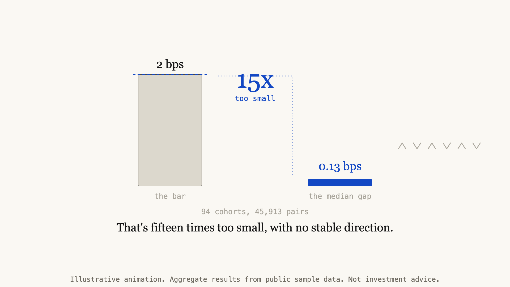

# Does the index-versus-ETF option gap survive matched moneyness?

**No.** Three independent datasets, 46,553 matched pairs, and the gap at equal
moneyness is well under one basis point. That is far smaller than the cost of
crossing either leg. This repository holds the measurement code, the rule fixed
before the data was opened, and the aggregate results.

---

## Why test this idea

SPY is an ETF that holds the S&P 500. SPX options are options on the index itself.
Both give exposure to the same 500 companies, so a call on SPY and a call on the
index with the same expiry and the same moneyness should cost about the same. If one
side stays more expensive by more than it costs to trade, that is an arbitrage-style
edge. Sell the rich leg, hold the cheap one, and collect the difference as the
prices converge.

The catch is that the same strike is not the same moneyness. The index trades around
ten times the ETF's price, so an index option at strike 4000 and an ETF option at
strike 400 are different contracts. One is at the money and the other is deep out of
it. This repository makes that comparison at matched moneyness and reports whether
anything survives.

## Method

This is the method that produced `results/cohort_2022h2.csv`, and
`src/matched_moneyness.py` implements it with these defaults.

1. **Two roots only.** The ETF leg is root `SPY` and the index leg is root `SPXW`.
   The root is the contract symbol with its last 15 characters removed, so the
   AM-settled `SPX` monthlies are excluded.
2. **Ratio from the closes.** On each quote date,
   `ratio = SPXW underlying_close / SPY underlying_close`.
3. **Nearest strike.** Every quoted SPY call strike `K` is paired with the quoted
   SPXW call on the same expiry whose strike is nearest to `K × ratio`. Ties go to
   the lower strike. All SPY call strikes are used, with no window around spot and
   no limit on how far the nearest SPXW strike may be.
4. **Short expiries.** Only expiries 1 to 7 calendar days after the quote date.
5. **Gap in basis points.** `gap = (SPXW mid / ratio - SPY mid) / K`, in basis
   points of the ETF strike. Positive means the index leg is richer.
6. **Cohort by expiry.** One cohort is one expiry date. Pairs from every quote date
   that saw that expiry are pooled and summarised by their median.
7. **Drop bad quotes.** Blank, zero, one-sided or crossed quotes are removed. A
   zero bid is not a price.

Input schema, one CSV row per contract and one quote date per snapshot, with the
column names of the HistoricalData.net daily files. Other columns are ignored.

| column | meaning |
|---|---|
| `contract` | OSI symbol, e.g. `SPXW220819C03620000` |
| `quote_date` | YYYY-MM-DD session of the row |
| `expiration` | YYYY-MM-DD |
| `type` | `call` or `put` |
| `strike` | strike in the instrument's own units |
| `bid`, `ask` | end-of-day quote |
| `underlying_close` | close of the underlying on `quote_date` |

### The rule, fixed before the data was opened

| test | threshold |
|---|---|
| effect size | median matched gap **≥ 2.0 bps** |
| stability | same sign in **≥ 60%** of cohorts |
| null band | median within **±1.0 bps** of zero |
| coverage | at least **8 cohorts**, at least 8 strikes per cohort |

A result above the effect threshold and consistent in sign would be worth designing
a trade around. A result inside the null band is not supported. Anything between is
inconclusive. These numbers were not adjusted after seeing results.

## What went wrong first

Three mistakes, each of which produced a number that looked like a real effect.

- **The same-strike artefact.** Comparing options at identical strikes produced gaps
  of **19 to 24 bps**. Identical strikes put the two legs at different moneyness,
  because the two instruments do not trade at the same price. Matching on moneyness
  removed the effect and the gap fell below one basis point. This was the biggest
  error and it is why the method exists. `tests/` reproduces it on synthetic data.
- **Snapshot skew.** Pulling each leg from a separately cached source gave quotes
  minutes apart. Refetching did not help, because the timestamps were frozen across
  repeated requests. For a sub-basis-point effect, two different minutes are not a
  measurement.
- **Opening-auction quotes.** The first prints of a session are the least settled of
  the day, and they exaggerated the gap by roughly ten times compared with the same
  instruments later in the session.

## Results

Three datasets, different vendors and different years. All aggregate. No raw data is
included.

| dataset | period | matched pairs | cohorts | median matched gap | verdict |
|---|---|---:|---:|---:|---|
| ETF vs index, end-of-day panel | 2026 | 582 | 12 | **−0.39 bps** | not supported |
| ETF vs index proxy, end-of-day panel | 2026 | 58 | 2 | **−0.60 bps** | not supported |
| **Free end-of-day sample, ETF vs index** | **2022 H2** | **45,913** | **94** | **−0.13 bps** | **not supported** |

The 2022 sample is the strongest test. It has 94 expiry cohorts over 127 trading
days, from a different vendor and a different volatility regime. Its median is
fifteen times smaller than the effect threshold, and 62 of 94 cohorts were negative
against 32 positive.

Only the 2022 H2 row can be regenerated from this repository.
`examples/reproduce_from_sample.py` rebuilds it from the vendor's sample and matches
all 94 cohorts, pair counts exactly and medians to three decimals. The two 2026 rows
come from earlier work on data that cannot be redistributed.

Cohort-level medians for the 2022 sample are in `results/cohort_2022h2.csv`. That
CSV holds only per-expiry aggregates, three columns of expiry date, pair count and
median gap, derived from the source credited below. The two 2026 rows appear as
summary figures in the table only, with no file, because that vendor's terms allow
aggregated statistics but not machine-readable files of its data. No row-level or
raw option data is included anywhere in this repository.

### How much depends on the method

The 2022 H2 verdict holds under every variant tried. The sign mix and some single
cohorts do not.

| variant on the 2022 H2 sample | pairs | median | negative / positive | same-sign share |
|---|---:|---:|---:|---:|
| published method (ratio from closes) | 45,913 | −0.128 bps | 62 / 32 | 0.660 |
| ratio from put-call parity forwards | 45,913 | −0.130 bps | 54 / 39 | 0.585 |
| published method, nearest strike within 1 ETF point | 39,965 | −0.150 bps | 59 / 34 | 0.638 |

The parity variant takes each forward from strikes within 2% of that root's own
close. In the parity and tolerance rows one cohort median rounds to zero, so their
counts sum to 93. The parity same-sign share of 0.585
sits below the 0.60 stability bar, so the two-thirds figure in the conclusion holds
only for the published method.

The nearest SPXW strike is more than 1 ETF point away for 5,948 of the 45,913
pairs, 13.0%. The furthest is 21.1 ETF points away. The 1-point tolerance row shows
what dropping those pairs does. The code takes the tolerance as `max_offset`, and it
defaults to no limit because that produced the published table.

Two cohort-filter changes leave the table unchanged. Counting distinct strikes per
cohort instead of pooled pairs, or requiring 8 pairs on each quote date before
pooling, keeps the same 94 cohorts with the same numbers. The code now counts
distinct strikes by default.

### Caveats

- **2022 was a different regime.** Rates and volatility were higher than today.
  Agreement across regimes strengthens the negative result. A positive result there
  would not have licensed a trade today.
- **Ex-dividend cohorts swing with the method.** SPY goes ex-dividend on 2022-09-16
  and 2022-12-16. Those cohorts read +2.9 and +2.1 bps with the published method but
  −26.8 and −26.9 bps with parity forwards. SPY calls are American and the closes
  ignore the lump dividend, so neither ratio prices those expiries cleanly.
- **One timestamp is not verified.** The vendor documents `underlying_close` as the
  16:00 ET close for ETFs and the official closing level for indices, while SPY and
  SPXW options quote until 16:15 ET. The 2022 files carry no quote timestamps, so
  whether both legs reflect the same moment is unverified.
- **No within-day timestamps** in the 2022 sample, so stale quotes cannot be filtered
  out. That adds noise in both directions.
- **Cohorts are not independent.** Each expiry appears on several consecutive
  sessions, so the effective sample is nearer 94 than 45,913. Nothing here is offered
  as statistical inference.
- **Pre-registration timing.** The rule was written down before the 2022 data was
  opened, but the two 2026 panels had already been looked at in earlier work. For
  those panels the threshold is applied post hoc. The 2022 result is the genuine
  out-of-sample test.

## Conclusion

Not supported. At matched moneyness the gap between an ETF option and the
corresponding index option is **well under one basis point** across all three
datasets, −0.13 to −0.60 bps. Crossing a single leg costs on the order of 0.5 bps,
so no version of this trade pays for its own execution, let alone produces a
persistent arbitrage.

With the published method the sign is mildly sticky, and about two thirds of cohorts
share a direction. With parity forwards that drops to 0.585. Either way, stickiness
without magnitude is not an edge.

A dataset would change the answer if it cleared a median of 2 bps or more in a
consistent direction across at least 8 expiry cohorts, measured on both legs at a
single timestamp. Nothing tested so far has come within an order of magnitude of
that bar.

## Reproduce it yourself

```bash
python3 -m venv .venv && .venv/bin/python -m pip install -r requirements.txt

# unit tests (synthetic fixtures, no data, no network)
.venv/bin/python -m pytest tests -q

# rebuild the 2022 H2 table from your own download of the vendor sample
# (options_sample_2022H2.zip, or its extracted day_by_date folder)
.venv/bin/python examples/reproduce_from_sample.py /path/to/options_sample_2022H2.zip
```

The script needs only the standard library. It prints the regenerated summary, a
cohort-by-cohort diff against `results/cohort_2022h2.csv`, and the variants in the
table above. It exits 0 when every published cohort matches. Pass `--out FILE` to
write the regenerated table. Keep the download outside the repository and do not
commit it.

To measure your own data, load one quote date with
`mm.load_snapshot(rows)` using the schema above, then call
`mm.measure_snapshot(snapshot)` and `mm.cohort_table(pairs)`. `ratio_method="parity"`
and `max_offset=1.0` give the variants.

### Where to get free data

- **[HistoricalData.net](https://historicaldata.net/options.html)** has a free
  end-of-day option sample covering SPY and SPX/SPXW from July to December 2022,
  with a documented schema and one close per day. The 2022 H2 result above is
  computed from it. Its licence allows publishing statistics but not the data, so
  none of the data is included here. Download it yourself and read their licence.
- **Source: Market Data ([https://www.marketdata.app](https://www.marketdata.app))**
  offers free-tier end-of-day option quotes, 24-hour delayed, with up to a year of
  history. The two 2026 rows in the results table are aggregate statistics derived
  from it. No data from this source is included. See their
  [terms](https://www.marketdata.app/terms/public-use/).
- **Cboe delayed quotes** give free delayed option chain snapshots at
  `https://cdn.cboe.com/api/global/delayed_quotes/options/SYMBOL.json`, with index
  roots prefixed by an underscore (`_SPX`, `_XSP`, `_NDX`, `_RUT`). They are delayed,
  snapshot only and **cached per root**. The timestamps of two roots can be minutes
  apart, which makes them unsuitable for a two-leg comparison without a staleness
  check. Review Cboe's terms before any automated use.

## Limitations

- Close-based prices are not executable. A gap measured at the close says nothing
  about what you could have traded.
- The method compares mid prices. A real trade crosses the spread, which is larger
  than the effect being measured.
- Only calls were used. A put-side test would be a useful independent check.
- The ratio comes from two closing prints, not from the option prices, and the
  nearest listed strike can sit well away from exact moneyness. Both choices move
  the sign mix, as the variant table shows.
- Nothing here accounts for borrow, financing, dividends or settlement mechanics.

## Side ideas

Short write-ups of side ideas about why a gap might exist, with what ran and what each found, are in [docs/exploratory](docs/exploratory/README.md). All of them are exploratory and none changed the verdict above.

## Video and diagram

A 90-second narrated explainer of why this idea was tested and what came out is at
[`assets/opt-gap-explainer.mp4`](assets/opt-gap-explainer.mp4).



## Licence

MIT. See `LICENSE`.
